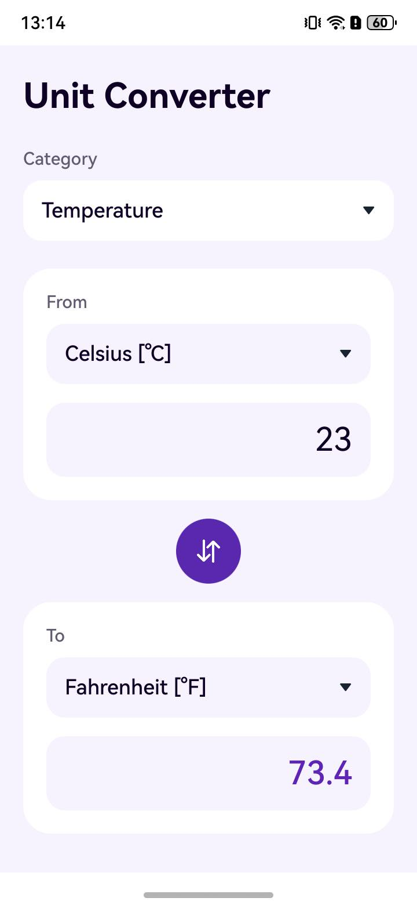

# Unit Converter

An OpenHarmony example app for converting length, weight, volume, temperature, and pressure on a default-type device.

## What this example demonstrates

| Capability | API or platform service | Where to look |
| --- | --- | --- |
| Select a category and source/target units | ArkUI `Select` | [Index.ets](entry/src/main/ets/pages/Index.ets), [UnitSelector.ets](entry/src/main/ets/components/UnitSelector.ets) |
| Enter a signed decimal value and show the conversion | ArkUI `TextInput`, `@State`/`@Observed` state | [Index.ets](entry/src/main/ets/pages/Index.ets), [UnitConverterViewModel.ets](entry/src/main/ets/pages/viewmodels/UnitConverterViewModel.ets) |
| Convert between five categories and format the result | Local conversion factories and formatter | [MeasureFactory.ts](entry/src/main/ets/feature/MeasureFactory.ts), [ConversionFormatter.ts](entry/src/main/ets/feature/ConversionFormatter.ts) |
| Show English and Chinese labels | OpenHarmony string resources | [base strings](entry/src/main/resources/base/element/string.json), [Chinese strings](entry/src/main/resources/zh_CN/element/string.json) |

Supported units: length (meter, kilometer, mile, foot, inch); weight (gram, kilogram, pound); volume (liter, US gallon, UK gallon); temperature (Celsius, Kelvin, Fahrenheit); and pressure (pascal, bar, psi).

## Preview



## Requirements

- Oniro App Builder (`@oniroproject/oniro-app`) 0.10.0, OpenHarmony SDK 6.1 (API 23), OpenHarmony command-line tools, and Java on `PATH`. The repository's CI uses Node.js 20 and JDK 17.
- An OpenHarmony default-type device or emulator compatible with API 20 or later to run the HAP. The build targets API 23 and does not request permissions or use external services.
- Local development signing. The generated certificate and profile are for development builds; release distribution needs its own signing setup.

## Build and run

From the repository root, create a local profile once, generate development signing material, and build:

```sh
cp build-profile.example.json5 build-profile.json5
oniro-app sign
oniro-app build
```

On PowerShell, use `Copy-Item build-profile.example.json5 build-profile.json5` for the first step. The profile and signing files are ignored by Git. Do not copy the example over an existing local signing profile.

The signed HAP is `entry/build/default/outputs/default/entry-default-signed.hap`. With a compatible device or emulator connected, run `oniro-app app install` and `oniro-app app launch` from the repository root. These commands use the project manifest to select the HAP and launch `com.example.unitconverter`.

## Use

1. Open Unit Converter and select a category.
2. Select the source and target units.
3. Enter a value, including a negative or decimal value, to update the result.
4. Tap the swap button to exchange the units and recalculate.

## Explore the implementation

[EntryAbility.ts](entry/src/main/ets/entryability/EntryAbility.ts) opens the [Index.ets](entry/src/main/ets/pages/Index.ets) page. The page binds its controls to [UnitConverterViewModel.ets](entry/src/main/ets/pages/viewmodels/UnitConverterViewModel.ets), which selects a converter from [MeasureFactory.ts](entry/src/main/ets/feature/MeasureFactory.ts) and formats finite results with [ConversionFormatter.ts](entry/src/main/ets/feature/ConversionFormatter.ts). Category and unit labels are mapped in [MeasureLabels.ets](entry/src/main/ets/resources/MeasureLabels.ets) and [UnitLabels.ets](entry/src/main/ets/resources/UnitLabels.ets).

## Verify

After installing the HAP, manually select each category and confirm its listed units, enter a value and check that the result updates, then swap the units and confirm recalculation. Try a negative decimal, clear the input, and check that malformed input does not show a stale result. Check the labels and controls with a screen reader if accessibility is relevant to your device.

With Node.js 24, the formatter also has a source-level check: `node --test tests/conversion-formatter.test.mjs`.

## Limitations

The app requests a decimal keyboard from the system, but the keyboard layout depends on the device's input method. You may need to enter or paste a minus sign or decimal point using that input method. Results are formatted to fit the result field, with up to eight decimal places.

## Contributing

These apps are focused examples of specific platform capabilities. Contributions that keep an example correct, buildable, and clear are welcome, including bug fixes, documentation and setup corrections, and improvements to its existing behavior. Please keep pull requests within the app's stated purpose and describe how you verified the change.

**Found a problem but can't fix it?** Open an issue in this repository; a pull request is not required. For a bug or broken build, include the steps to reproduce it, what you expected, what happened, and your device, OS, and SDK/API version. Logs or screenshots are helpful when available. You can also open an issue for inaccurate or unclear documentation.

## License

This project is licensed under the Apache License, Version 2.0. See [LICENSE](LICENSE).
